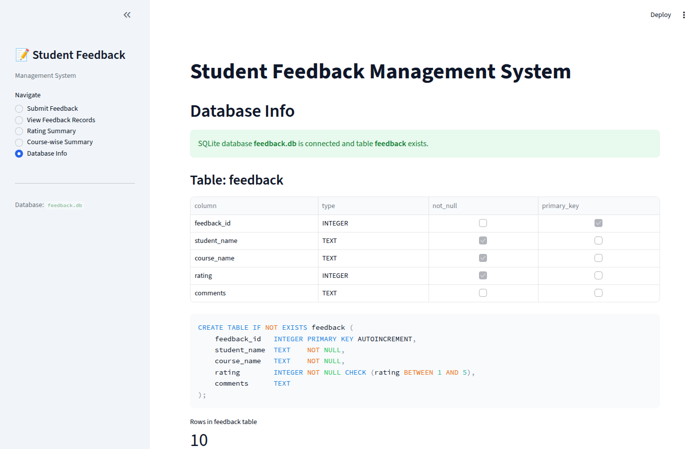
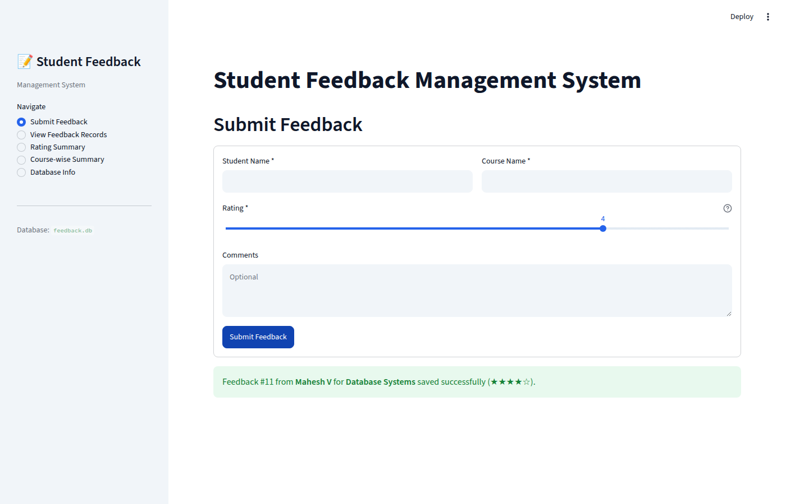
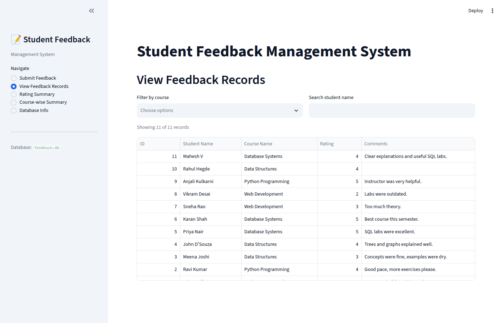
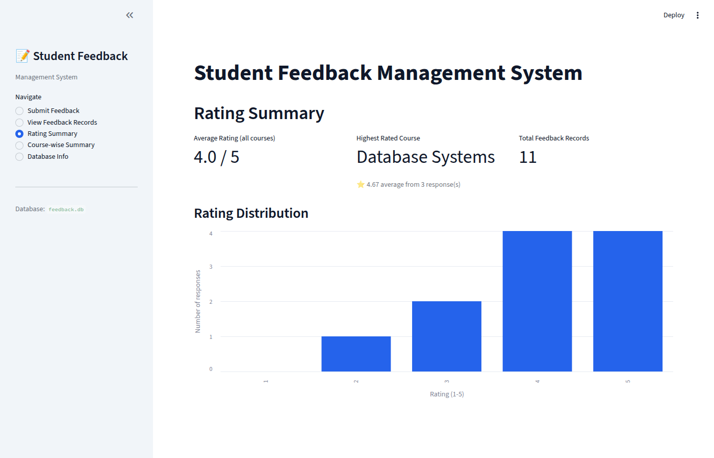
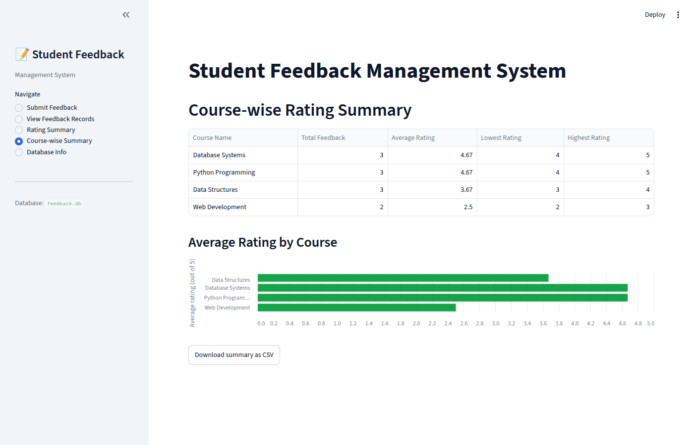

# Project Report – Student Feedback Management System

**Assessment:** AI-Assisted Software Engineering
**Stack:** Python · Streamlit · SQLite · Virtual Environment · Git
**Development approach:** Built through prompting with an AI assistant (Claude); all prompts are in [PROMPTS.md](PROMPTS.md).

---

## 1. Problem Statement

Institutions collect course feedback from students but often keep it in paper forms or scattered spreadsheets, which makes it hard to see how a course is doing or compare courses. The goal is a simple web application where a student can submit feedback (name, course, rating, comments) that is stored in a SQLite database (`feedback.db`), and where staff can view all records and see summary statistics: the overall average rating, the highest-rated course, and a course-wise rating summary.

## 2. Features Implemented

| # | Feature | Implementation |
|---|---------|----------------|
| 1 | **Submit Feedback** | Streamlit form with Student Name, Course Name, Rating (slider 1–5), Comments. Validates required fields and rating range; shows a success message with the new feedback ID or specific error messages. Form clears after submit. |
| 2 | **View Feedback Records** | Table of all records (newest first) with course multiselect filter and student-name search; shows "x of y records". |
| 3 | **Average Rating** | `AVG(rating)` over all feedback, shown as a metric (e.g. 4.0 / 5), plus a rating-distribution bar chart. |
| 4 | **Highest Rated Course** | Course with highest average rating; ties broken by more responses, then alphabetically, so the answer is deterministic. Shows its average and response count. |
| 5 | **Course-wise Rating Summary** | Per course: total feedback, average, lowest and highest rating; horizontal bar chart of averages; CSV download. Developed on branch `feature/category-summary`. |
| + | **Database Info** | Confirms `feedback.db` is connected, shows the `feedback` table schema, the CREATE TABLE SQL and the row count. |

Every page handles an empty database with a friendly message instead of an error.

## 3. Database Design

- **Database file:** `feedback.db` (created automatically on first run by `database.init_db()`)
- **Table:** `feedback`

```sql
CREATE TABLE IF NOT EXISTS feedback (
    feedback_id   INTEGER PRIMARY KEY AUTOINCREMENT,
    student_name  TEXT    NOT NULL,
    course_name   TEXT    NOT NULL,
    rating        INTEGER NOT NULL CHECK (rating BETWEEN 1 AND 5),
    comments      TEXT
);
```

| Column | Type | Purpose / constraint |
|--------|------|----------------------|
| feedback_id | INTEGER | Unique ID, auto-generated primary key |
| student_name | TEXT | Required |
| course_name | TEXT | Required; used for grouping in summaries |
| rating | INTEGER | Required, 1–5 enforced by CHECK constraint and app validation |
| comments | TEXT | Optional free text |

**Key queries** (all parameterised to prevent SQL injection):

| Feature | SQL |
|---------|-----|
| Submit | `INSERT INTO feedback (student_name, course_name, rating, comments) VALUES (?, ?, ?, ?)` |
| View | `SELECT ... FROM feedback ORDER BY feedback_id DESC` |
| Average | `SELECT AVG(rating) FROM feedback` |
| Highest rated | `SELECT course_name, AVG(rating), COUNT(*) FROM feedback GROUP BY course_name ORDER BY AVG(rating) DESC, COUNT(*) DESC, course_name LIMIT 1` |
| Course summary | `SELECT course_name, COUNT(*), AVG(rating), MIN(rating), MAX(rating) FROM feedback GROUP BY course_name` |

**Architecture:** `database.py` holds all data access; `app.py` is only UI. This separation made every feature unit-testable without a browser.

## 4. Screenshots

| # | Evidence | File |
|---|----------|------|
| 1 | SQLite database successfully created |  |
| 2 | Record added successfully |  |
| 3 | View records page |  |
| 4 | Summary calculation (average + highest-rated course) |  |
| 5 | Category (course-wise) summary |  |
| 6 | Git branch creation |  |
| 7 | Successful Git push |  |

## 5. Prompts Used

Full text of each prompt and its outcome is in [PROMPTS.md](PROMPTS.md). Summary:

1. Requirements Generation – functional requirements, validation rules, edge cases, acceptance criteria
2. Database Design – schema with constraints and all feature queries
3. Application Development – modular `database.py` + multi-page Streamlit `app.py`
4. Testing – pytest unit tests and Streamlit AppTest UI tests
5. Improvement – fix failing UI test (table not initialised)
6. Improvement – UI polish after reviewing screenshots (metric delta, chart labels)
7. Improvement – sample data script and Windows run script
8. Documentation – README and this report
9. Git Operations – init, commit, branch, push

## 6. Testing Performed

**Automated – `python -m pytest -v` → 27 passed**

| Area | Tests |
|------|-------|
| Database creation | Table exists with the exact 5 columns; `init_db` is idempotent and doesn't wipe data; DB-level CHECK rejects rating 9 |
| Feature 1 – Submit | Returns new ID; trims whitespace; rejects empty name, blank name, empty course, rating 0, 6 and 3.5; SQL-injection text stored safely |
| Feature 2 – View | All records returned newest first |
| Feature 3 – Average | (5+4+3+2+5)/5 = 3.8; `None` when empty |
| Feature 4 – Highest rated | Correct course; tie-break by response count; `None` when empty |
| Feature 5 – Course summary | Correct count/avg/min/max per course; sorted by average; empty list when empty |
| UI (AppTest) | Successful submit shows success message and stores row; empty submit shows 2 errors and stores nothing; all pages render with and without data; summary metrics show correct values |

**Manual testing** – ran the app in the browser, loaded sample data with `seed_data.py`, submitted a new record, and checked each page (screenshots 1–5). Verified summary numbers by hand against the sample data (e.g. Database Systems: 5, 5, 4 → 4.67).

## 7. Learning Outcomes

- **Prompt engineering:** Specific prompts (exact columns, constraints, function names, edge cases) produced code that needed little rework; vague prompts would have left gaps such as tie-breaking and empty-database handling.
- **Iterating with AI:** Pasting the exact failing test error back into the assistant fixed the issue quickly; reviewing screenshots surfaced UI issues (a misleading metric arrow) that tests didn't catch.
- **Database design:** Enforcing rules in both the app and the schema (CHECK constraint) gives defence in depth; parameterised queries prevent SQL injection.
- **Testable architecture:** Keeping SQL in `database.py` with an injectable `db_path` allowed fast, isolated tests against temporary databases.
- **Streamlit:** Forms, metrics, charts, sidebar navigation and headless `AppTest` testing.
- **Environment & Git:** Isolating dependencies in a virtual environment, excluding `venv/` and caches from Git, and developing a feature on a dedicated branch before pushing.
